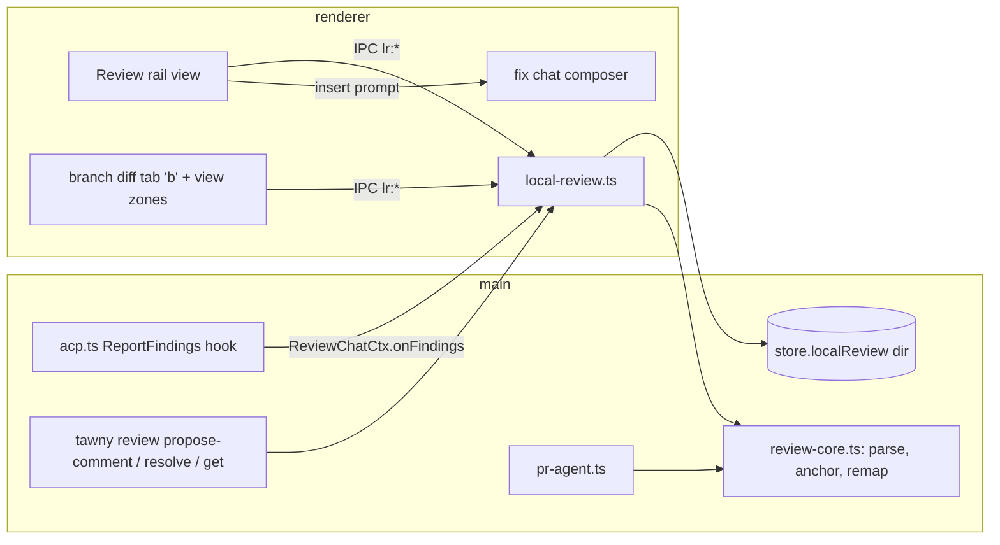
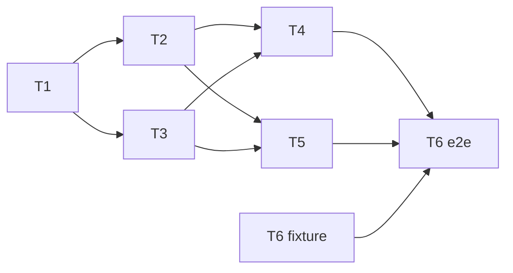

# Plan: Local review (review your own branch)

Status: design locked 2026-11-10 (grilled via /scope). T1-T5 done; T6 end-to-end pending (shared renderer pieces in `src/renderer/src/components/review/`: ItemCard, showReviewZones + ReviewZoneSource, Composer, reveal, ChangedFilesList, viewed store); T2 adds `tawny review resolve <id>` with the note on stdin (quoted heredoc) and `buildFixPrompt` in `src/shared/local-review.ts`.

A **local review** runs /code-review on the current worktree's own branch changes (no GitHub PR) and shows the results the same way PR review sessions do: inline view zones in Monaco diff tabs and a list of items. The items are a **fix list for an agent**. You check the ones you want and send them to a chat, and that chat marks them fixed as it goes.

Builds on PR review sessions ([pr-review-plan.md](pr-review-plan.md)). Read that first.

## Decisions

| # | Topic | Choice |
|---|---|---|
| Q1 | Purpose | Fix list for an agent. Items are agent findings plus your own gutter comments (with an optional suggestion) |
| Q2 | Chats | A **dedicated review chat** in the current workspace runs the review. "Send to agent" asks which chat does the fixes (default: the most recently active non-review chat in the worktree) |
| Q3 | Diff base | `merge-base(<base>, HEAD)` to the **working tree** (commits on the branch plus uncommitted and untracked changes). Default base is `main` (else the repo's default branch). You can change it in the Review popover (branch or commit, via `BranchPicker`) |
| Q4 | Drift | Each item stores an anchor (its line text plus 2 lines of context on each side). After edits it is remapped to the nearest match. If there's no match it shows an **Outdated** badge at its last known line. Inside an open diff, Monaco decorations track lines live |
| Q5 | Closing | Status flow: `open → sent → fixed`, plus `dismissed`. The fix chat runs `tawny review resolve <id> --note "<what changed>"` to mark an item fixed. You can reopen or dismiss any item |
| Q6/Q7 | UI | A new **"Review" view on the tree pane's rail** (next to Asks). It holds the Review button and popover, the branch-changes file list (viewed checkboxes) and the items grouped by file. Clicking a file opens a branch diff tab with view zones |
| Q8 | Code | **Pull the shared parts out** of PR review (finding parsing, the item card, the view-zone host, the files list, remapping) and add a new local-review module. PR review switches to the shared parts and gets remapping as a bonus. PR review needs a regression check |
| Q9 | Send | Each open item has a checkbox (all checked by default) and editable text. "Send N to agent" builds one prompt and **inserts it into the chosen chat's composer** without sending. The sent items become `sent` |
| Q10 | Lifetime | Each run adds to the list and skips duplicates (same path, remapped line and summary as an open item). Items persist per worktree across restarts. "Clear resolved" removes fixed and dismissed items, and removing the worktree drops everything. Each item records which run it came from |
| Q11 | Agent | Claude only. The review chat's system prompt is extended with the base, the merge-base sha and "review only, never edit". It also gets `tawny review propose-comment`. The run is `/code-review <effort> <base> <instructions>`: always an explicit effort level, **never** `--fix` / `--comment` |

## Researched facts

- **The /code-review target is a base branch.** The bundled CLI's text says "Pass the base branch explicitly (e.g. `/code-review develop`)" and "Could not find merge-base with X", so a branch argument means "diff from merge-base with X". **Unverified:** whether it includes uncommitted or untracked changes. Always add to the instructions: "Include uncommitted and untracked working-tree changes."
- **ReportFindings capture**: `src/main/acp.ts:711` reads `rawInput.findings` only when the chat has a `PrChatCtx` (`acp.ts:311`). That is set by `agents.prContext` (`agents.ts:109`, `:514`), wired in `main.ts:843` to `PrAgent.context`.
- **PR findings**: type `PrFinding` (`src/shared/types.ts:19`), stored in `store.data.prFindings[dir]` (`store.ts:90`). Parsing is in `PrAgent.fromReport` and `propose` (`src/main/pr-agent.ts`). CLI methods are registered through `Registry` (`src/main/cli/registry`).
- **Renderer**:
  - `showPrThreads` (`editor/prThreads.tsx:108`) draws threads, drafts and findings for `'r'` diffs (`editor/host.ts:468`, `:756`). Reveal goes through `prReveal.ts`.
  - The cards are `FindingCard` and `FindingsSection` (`workspace/PrFindings.tsx`). `DoReview` (same file, `:216`) is the effort/instructions popover. The gutter composer is `Composer` in `workspace/PrDrafts.tsx`.
  - `PrFilesView.tsx` is the merge-base file list with viewed checkboxes (`H.saveUi({prViewed})`).
- **Rail**: `RAIL` in `tree/TreePane.tsx:55`. The views are files, pr, changes, find, debug and asks (`AsksView.tsx` is the closest analogue).
- **Diff helpers**: `files.ts` (`gitChanges`, file content at a ref `:401`). `sendTextToAgent` exists in `lib/`.
- **Fixtures**: `TAWNY_ACP_FIXTURE` (`acp.ts:403`). `test/fixtures/acp/pr-code-review.jsonl` already has a ReportFindings turn. The gh fixture is in `test/fixtures/gh/`.

## Architecture



Store shape (new key, per worktree dir):

```ts
localReview?: Record<string, {
  base: string;              // 'main' or a ref the user picked
  runs: { id: string; chatId: string; mergeBase: string; at: number }[];
  reviewChats: string[];     // chat ids that are review chats (get the ctx + prompt)
  items: ReviewItem[];
}>;
```

`ReviewItem` (shared, in `src/shared/types.ts`): `{ id, source: 'review'|'propose'|'user', path, line, startLine?, side: 'RIGHT', body, detail?, suggestion?, category?, verdict?, anchor?: { text: string; before: string[]; after: string[] }, outdated?: boolean, status: 'open'|'sent'|'fixed'|'dismissed', note?, runId?, createdAt }`. `PrFinding` keeps its own `status` and `headSha` but shares the parsing and anchor fields.

## Tickets

Rules for every ticket: follow AGENT.md (own dev instance, verify via CDP, typecheck + lint, WCAG checks in mocha and latte, `@/ui` components only). Use ACP and gh fixtures, never real agent or GitHub calls.

### T1. Shared review core (main + shared types)

Blocked by: none.

- Add `src/main/review-core.ts`:
  - `parseReportFindings(dir, toolCallId, list)`: moved out of `PrAgent.fromReport`, including the absolute-path stripping.
  - `parseProposal(args)`: moved out of `PrAgent.propose`.
  - `captureAnchor(fileText, line)`.
  - `remap(item, fileText) → { line, outdated }`: nearest exact match of the anchor block, then a unique match of the line alone, else outdated.
- Add `ReviewItem` and the shared anchor type to `src/shared/types.ts`. `PrFinding` gets the optional `anchor` and `outdated` fields.
- Generalize `PrChatCtx` into `ReviewChatCtx` (`acp.ts:311`), same shape. Turn `agents.prContext` into `reviewContext`, which main resolves as the PR context first and the local-review context second.
- `PrAgent` uses the core:
  - captures anchors from the worktree file when a finding is added
  - remaps findings when listing them (the PR bonus from Q8), without breaking the existing `headSha` outdated badge
- Unit-test parse and remap if the repo has a test runner, otherwise test with a script.
- Done when: PR review behaves the same against `test/fixtures/gh` + `pr-code-review.jsonl` (findings show up, Add to review works), and typecheck and lint pass.

### T2. Local review backend (main, IPC, CLI)

Blocked by: T1.

- Add `src/main/local-review.ts` (class `LocalReview`, EventEmitter `changed`) with the store key above:
  - `state(dir)`: base, merge-base, items (remapped against current files) and runs
  - `setBase(dir, ref)`
  - `files(dir)`: name-status of `merge-base..working tree` plus untracked files
  - `addUserItem`, `editItem` (body/suggestion), `setStatus`, `clearResolved`
  - `startReview(dir, {effort, instructions})`: creates the review chat, records the run and the chat id in `reviewChats`, and sends `/code-review <effort> <base> <instructions + "Include uncommitted and untracked working-tree changes.">`. Never `--fix` / `--comment`.
  - `markSent(dir, ids)`
- `context(dir, chatId)` returns a `ReviewChatCtx` only for chat ids in `reviewChats`. The system prompt appends the base, the merge-base sha, "review only, never edit files" and the propose CLI usage.
- CLI (`Registry`, under the `review.` namespace, caller worktree from `TAWNY_WORKTREE`):
  - `review.propose_comment`: for review chats
  - `review.resolve {id, note?}`: for any chat in the worktree; sets the item to `fixed` with the note
  - `review.get`: the items with ids and statuses
- IPC `lr:*` in `main.ts` and `preload/index.ts`, exposed as `H.lr*`, plus a push event when items change. When a worktree is removed (`main.ts:643`), drop `localReview[dir]`.
- Done when: driving IPC and CLI from the dev instance console with a review-chat fixture (see T6) adds items, and `tawny review resolve` flips one to fixed.

### T3. Shared renderer pieces

Blocked by: T1.

- Extract a generic `ItemCard` from `FindingCard` (`PrFindings.tsx`). It takes the item plus injected actions and badges, so PR keeps "Add to review / Dismiss" and local gets checkbox / edit / status / reopen / dismiss. Badges show the state word as well as the colour (WCAG).
- Generalize the view-zone host in `prThreads.tsx` into a source-agnostic `showReviewZones(diff, root, rel, source)`. The source supplies items, threads (PR only) and the composer handler. Generalize `prReveal.ts` the same way.
- Extract the changed-files list from `PrFilesView.tsx` into a reusable component (rows, icons, viewed checkbox; viewed storage keyed by an identity string).
- [x] Done when: the PR UI looks and works exactly as before (screenshot before and after against the gh fixture, both themes).

### T4. Review rail view

Blocked by: T2, T3.

- Add a `'review'` entry to `RAIL` (`TreePane.tsx:55`) with an icon in the same stroke style, plus `tree/ReviewView.tsx`:
  1. **Header**: the base (e.g. "vs main @ abc1234") and a **Review** button. The popover reuses `DoReview`, extended with a base picker (`BranchPicker`) and defaults from the `prReview.effort` / `prReview.instructions` settings.
  2. **Files**: the shared files list (from T3) over `H.lrFiles`, with viewed checkboxes keyed by worktree. Clicking a file opens a `'b'` diff (T5).
  3. **Items**: grouped by file with `ItemCard`. Open items show a checkbox (checked by default) and inline edit. Statuses are Sent / Fixed (with the note) / Outdated / Dismissed. The footer has **Send N to agent** and **Clear resolved**.
- Send to agent: a chat picker (`@/ui` dropdown) listing the worktree's non-review chats. It builds one prompt per Q9 (for each item: id, `path:line`, body, suggestion, then the resolve-command instruction) and inserts it into that chat's composer via the existing insert path (`sendTextToAgent`-style, not submitted). Then it calls `markSent`.
- Leave the dev instance running for human UX sign-off (new UI surface).

### T5. Branch diff tabs with view zones and own comments

Blocked by: T2, T3.

- Add diff mode `'b'` (`editor/api.ts:215`, `editor/host.ts:468` / `:756`): left is the file at the merge-base, right is the live working-tree model (editable, so fixes show up immediately).
- Use `showReviewZones` with the local source: an item card per item, and a gutter click/drag opens the `Composer` for a `user` item (optional suggestion, RIGHT side only). Wire up reveal from the rail list.
- Live drift: while a tab is open, track item lines with Monaco decorations, and persist the new line and anchor on save (`lr` edit).
- [x] Done when: adding a comment in the gutter shows it in the rail, editing above an item moves it, and deleting its line marks it Outdated.

### T6. Fixture, end-to-end check, docs

Blocked by: none to start the fixture. Run the end-to-end check after T4 and T5.

- Add `test/fixtures/acp/local-code-review.jsonl`, adapted from `pr-code-review.jsonl`: a review turn with a ReportFindings tool call on files of a throwaway local branch, plus a turn where the agent runs `tawny review resolve`. Synthetic; no model calls.
- End to end on the dev instance:
  1. Review
  2. Items appear in the rail and the diff
  3. Edit an item
  4. Send 2 items to a chat (the prompt shows in the composer)
  5. Resolve through the CLI (the item becomes Fixed)
  6. Clear resolved
  7. Restart (items persist)
- PR regression pass with the gh fixture.
- Update `docs/pr-review-plan.md` (remapping now shared) and mark this plan's status.



Parallel: T2 ‖ T3, then T4 ‖ T5. The T6 fixture can start any time.

## Open risks

- /code-review may ignore uncommitted or untracked changes even with the instruction. The fallback: when the user has uncommitted changes, the popover offers "commit WIP first" or warns that they won't be reviewed. Confirm on the first real run.
- Duplicates across runs: the dedupe is an exact match (path, remapped line, summary). Paraphrased repeats will still show twice; accepted for v1.
- Remapping repeated or boilerplate lines (e.g. `}`): the context block keeps this mostly unambiguous. On a tie, pick the match nearest the old line.
- A finding's line may be in the base-only (deleted) part of the diff. ReportFindings has no side, so treat every line as RIGHT and mark items whose line is beyond the file's length as Outdated.
