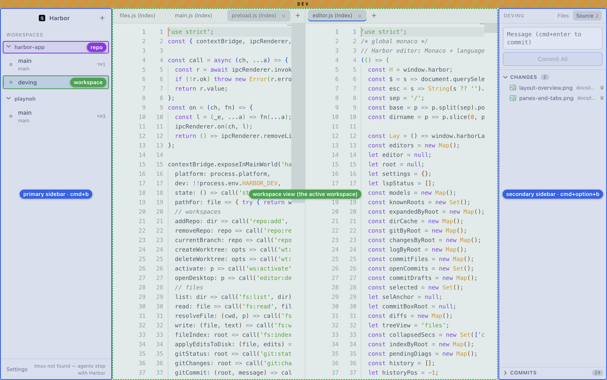
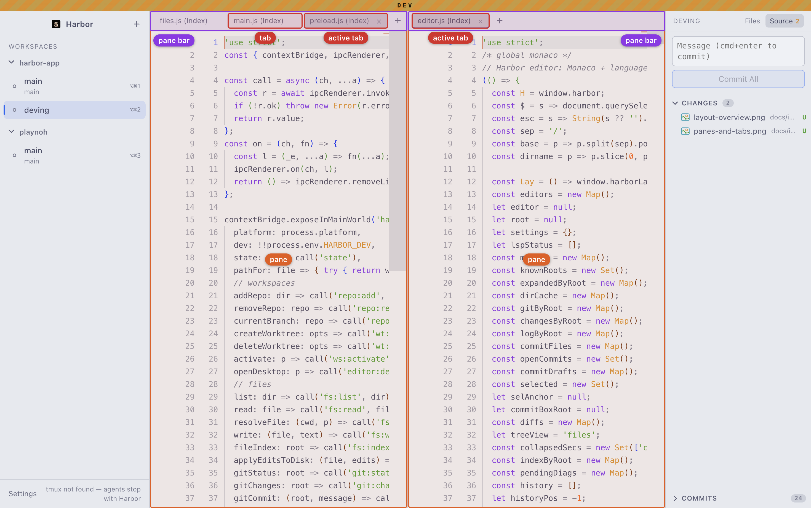

# Terminology

Names for the parts of the Tawny window. Use these in UI text, docs, code and conversation.

```
repo (optional)
└─ workspace   a git worktree, a folder or a scratch dir; one row in the primary sidebar
   └─ page     a set of split panes; a workspace has many, one shown at a time
      └─ pane  a split region of the page, with its own pane bar
         └─ tab   one agent, terminal, file or diff
```

## Window layout



| Term | What it is |
|---|---|
| **Primary sidebar** | Left. Toggle `cmd+b`. Lists repos and their workspaces. |
| **Repo** | Heading in the primary sidebar. Groups worktree workspaces; not selectable. Optional: workspaces without a repo sit above the repos, with no heading. |
| **Workspace** | A directory with its own pages and tabs. Click its row to switch; shows agent state and the `option+cmd+<n>` shortcut. Three kinds: **worktree** (a git worktree under a repo), **folder** (any directory, opened with File > Open Folder as Workspace) and **scratch** (a throwaway dir under Tawny's data dir, for a group of terminals; File > New Scratch Workspace). Double-click a folder or scratch row (or right-click > Rename) to rename it; empty resets to the folder name. Source shows "Not a git repository" when the directory isn't one. |
| **Workspace view** | The middle area: the active workspace's active page. Not a separate concept, just where the active workspace renders. |
| **Secondary sidebar** | Right. Toggle `cmd+option+b`. Three views: **Files** (file tree), **Source** (changes, commit box, Commits) and **Find** (`cmd+shift+f`, search and replace across the workspace's files). |
| **Status bar** | Bottom, full width. Ambient state; its right side holds the **Resource monitor** (total memory, CPU, tab count). |
| **Resource manager** | Popover from the resource monitor. Memory and CPU per workspace, then per agent/terminal tab (stop button per tab) and per language server. |

## Pages, panes and tabs



| Term | What it is |
|---|---|
| **Page** | A layout of split panes within a workspace. A workspace has many pages; one is shown at a time. Closing a page moves its tabs to a neighbouring page. |
| **Page bar** | Strip of page chips under the workspace view, with `+` for a new page. Double-click a chip to rename, drag a tab onto a chip to move it there. New page `cmd+option+shift+n`, previous/next `cmd+option+[` / `cmd+option+]`. |
| **Pane** | A split region of a page. Holds many tabs, shows one at a time. Created by dragging a tab to a pane's edge, or by moving the active tab to a neighbouring pane. |
| **Pane bar** | A pane's tab strip, with the `+` button for a new agent or terminal. |
| **Tab** | One item in exactly one pane: an agent, terminal, file or diff. Drag between panes or reorder in the bar. |

## Rules

- "Workspace" means one sidebar row, whatever backs it. Never use it for the middle area or the sidebar as a whole. Say "worktree" only for the git-backed kind.
- A tab is never split. Pages hold panes; panes are split; tabs live inside them.
- Say "agent tab", not "agent pane".

## Names in code that don't match yet

| Now | Should be |
|---|---|
| `group`, `gbar`, `gtab` in `src/renderer/layout.js` | `pane`, `pane bar`, `tab` |
| `#workspace` in `src/renderer/index.html` (middle area) | `#workspaceView` |
| `#treePane` | `#secondarySidebar` |
| `#sidebar` | `#primarySidebar` |
| README: "Agent pane per worktree" | "agent tab" |

The screenshots are from the dev instance, annotated by overlaying outlines on the live DOM.
